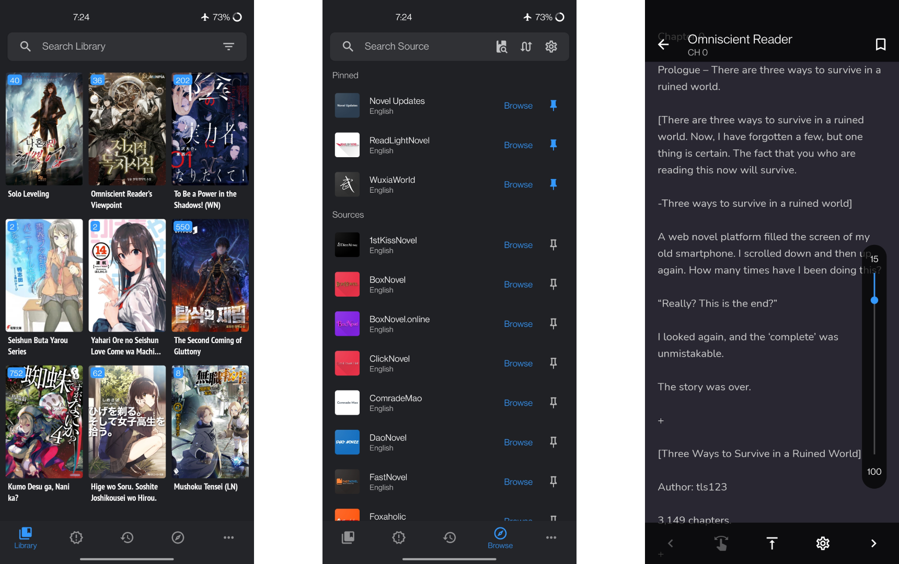
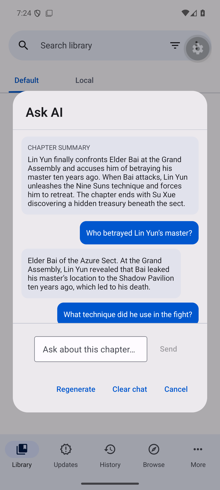
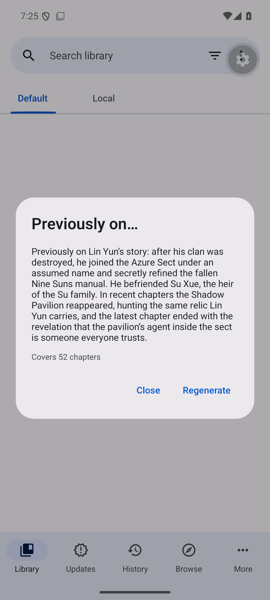

  

<h1 align="center">Capread</h1>

  Capread is a free and open source light novel reader for Android, built on top of
  <a href="https://github.com/lnreader/lnreader">LNReader</a> (MIT licensed) and inspired by Tachiyomi.

> Capread is a personal fork of [LNReader](https://github.com/lnreader/lnreader).
> All credit for the original app goes to the LNReader project; the original MIT
> license and copyright notice are kept in [LICENSE](./LICENSE).

  
  

  
  
  

<h2 align="center">Download</h2>

  
  

  Get the app from our <a href="https://github.com/Sidharth7082/Capread/releases">releases page</a>.

  <em>Android 7.0 or higher.</em>

<h2 align="center">Screenshots</h2>

  

## AI features (bring your own key)

Capread can summarize chapters, answer questions about what you are reading,
and show a "previously on…" recap of the chapters you have read. AI runs on
**your own** provider account: requests go straight from your device to the
provider you configure, and the API key never leaves your phone.

| Feature                                                               | Open it from    |
| --------------------------------------------------------------------- | --------------- |
| **Ask AI** — summarize the current chapter and ask questions about it | Reader menu → ⋮ |
| **Previously on…** — recap of the chapters you have read so far       | Novel menu → ⋮  |

The chapter text is sent as context with every question, so answers stay inside
the chapter you are reading — no spoilers from later chapters. Summaries and
chats are kept on device and included in backups.

  
  

### Setup

Open **More → Settings → AI**, enable AI features, then fill in three fields:

| Setting      | DeepSeek                                                    | OpenAI                                                           |
| ------------ | ----------------------------------------------------------- | ---------------------------------------------------------------- |
| API base URL | `https://api.deepseek.com`                                  | `https://api.openai.com/v1`                                      |
| API key      | from [platform.deepseek.com](https://platform.deepseek.com) | from [platform.openai.com](https://platform.openai.com/api-keys) |
| Model        | `deepseek-flash` (fast, cheap) · `deepseek-v4-pro` (best)   | `gpt-6-luna` (fast, cheap) · `gpt-6-astra` (best)                |

- **DeepSeek** is prepaid — top up a small balance first. A chapter summary on
  `deepseek-flash` costs a fraction of a cent, and off-peak hours are half price.
- **OpenAI** bills per token; `gpt-6-luna` is its cost-efficient model.
- Any OpenAI-compatible endpoint works, including local models via Ollama or
  LM Studio (leave the API key empty if your server does not need one).
- **Chapter context** (default: first 16,000 characters) controls how much of a
  chapter is sent — lower it to reduce cost, raise it for long chapters.
- Errors appear as toasts: `401` wrong key · `402` out of balance · `404` wrong
  base URL · `429` rate limit.

## Plugins

LNReader does not have any affiliation with the content providers available.

Plugin requests should be created at [lnreader-plugins](https://github.com/lnreader/lnreader-plugins).

## Translation

Help translate LNReader into your language on [Crowdin](https://crowdin.com/project/lnreader).

## Building & Contributing

See [CONTRIBUTING.md](./CONTRIBUTING.md)

## License

[MIT](https://github.com/lnreader/lnreader/blob/main/LICENSE)
